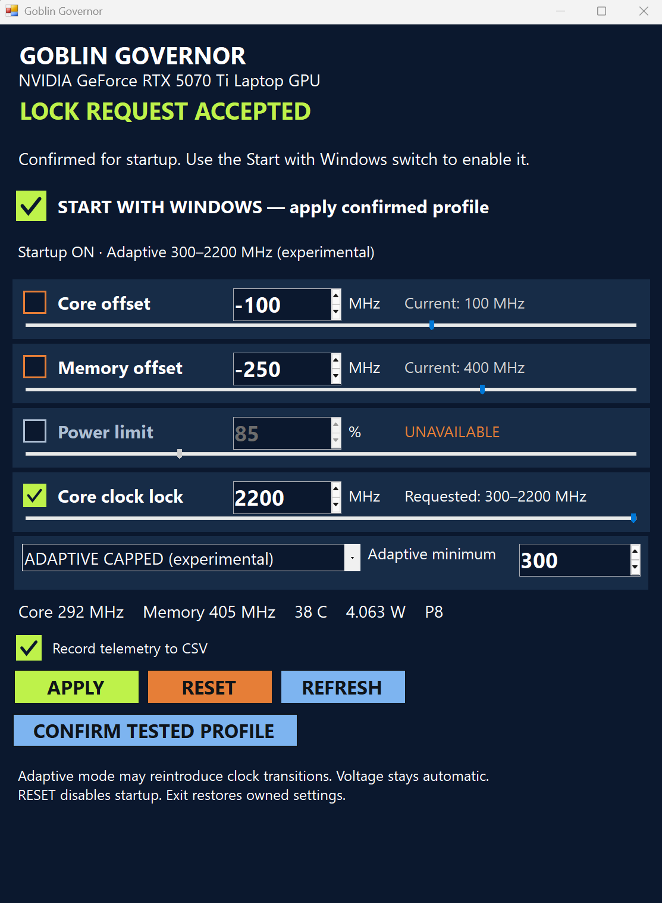

# Goblin Governor

**Put a leash on your GPU.**

Experimental NVIDIA GPU clock controls with large text, high-contrast checkboxes and a space-blue, lime-green and burnt-orange interface.

## Why this project exists

**Goblin Governor started because its owner needed their bloody laptop to work.** An expensive Acer Predator Helios Neo 18 AI (PHN18-72), with an NVIDIA GeForce RTX 5070 Ti Laptop GPU, kept crashing. This project grew from trying to make that machine usable, with simple clock controls and a readable interface.

The early results are encouraging: the owner reported success with a fixed 1,800 MHz request, and a later adaptive training run returned to low-power idle afterwards. These are observations from one laptop, not a guaranteed fix for other machines.

*Example from the original tester's configured laptop: adaptive 300–2200 MHz, with startup enabled after manual confirmation. Fresh installs have startup OFF and no confirmed profile. Requested limits and live clock readings are different; this screenshot shows the GPU idling at 292 MHz.*

### From frustration to experimentation

The owner described crashes during video rendering, AI work and graphics benchmarks, sometimes before a benchmark properly started. Previous Windows crash diagnostics identified repeated **VIDEO_TDR_FAILURE (0x116)** errors involving **nvlddmkm.sys**, NVIDIA's Windows driver. Those diagnostics identify the failure path; they do not establish whether the underlying cause is hardware, firmware, the driver or a combination.

Driver changes, clean installations, Windows troubleshooting and power-setting experiments had not produced a dependable solution. Returning the laptop or seeking warranty service remained options. But another question was worth testing: could controlling GPU clock behaviour make the machine reliable enough to use?

With help from AI coding tools, we built monitoring and clock-control software, then tested requests and watched what the GPU actually did. A possible connection between crashes and changing operating states motivated the experiment. **That connection remains a hypothesis, not a proven diagnosis.**

The owner reports that a fixed **1,800 MHz** request allowed a previously unreliable Unigine Heaven benchmark to complete. That was the first major breakthrough in the owner's experience. A saved benchmark score or complete run report has not been verified for this public package, so this remains an owner-reported result.

Next came a separate adaptive mode: let the GPU lower its clock at idle while keeping an upper limit under load. The original fixed implementation remains available as a fallback.

### What the records show

For the short training session on 14 November 2026, Governor recorded acceptance of a **300–2,200 MHz** range. Telemetry showed loaded clocks around **2,100 MHz**, a **2,115 MHz** peak, a maximum recorded GPU temperature of **62°C**, and a return to **292 MHz at roughly 4.3 W** after the workload. The training summary records completion of three epochs and 126 optimiser updates.

Two saved training summaries record **40.170 seconds** for the earlier fixed-1,800 run and **34.767 seconds** for the later run. Their recorded settings match: 335 examples, three epochs, batch size eight, 126 optimiser updates, seed 275, model parameter counts and software versions. Recorded epoch losses also match. Elapsed time is the only differing field in the training-summary objects.

That is an encouraging **single-run comparison**, not a controlled repeated benchmark. It does not isolate clocks from warm-up, caching or other system conditions, and it is not a promised performance improvement. The telemetry contains no incident markers or long sampling gaps during its short recording; it cannot establish long-term stability.

### Why share it?

Other owners facing similar symptoms may want a small tool they can inspect, test and improve. Goblin Governor is free and open source, with large text, clear selection states, explicit startup confirmation, monitoring and recovery mechanisms. Unsupported controls are reported as unavailable.

It is not an official NVIDIA or Acer utility, a guaranteed VIDEO_TDR_FAILURE fix, evidence that a hardware or driver fault has been repaired, or a replacement for appropriate warranty service.

We built it because the usual troubleshooting had not given this owner a dependable machine, and we wanted to find out what was possible. If it helps someone investigate their own laptop's behaviour, sharing the work will have been worthwhile.

**Built out of frustration. Tested through experimentation. Shared so others can try.**

---

## Download, build and open

Requires 64-bit Windows, .NET Framework 4.x and a compatible NVIDIA driver exposing NVML. Laptop support varies; unavailable controls remain unavailable. Administrator permission is required to run the app.

Extract the release ZIP to a permanent folder you own, then open `GoblinGovernor.exe`. Keep the whole folder in place while startup is enabled. Do not run it directly inside a ZIP. Release builds are unsigned; no certificates or instructions to disable Windows security are supplied.

To build from source, run `powershell -File .\build.ps1` from this folder. It uses the Windows .NET Framework 64-bit C# compiler and has no NuGet dependencies. To test without GPU writes, run `powershell -File .\test.ps1`.

A fresh copy has startup OFF, no confirmed profile and no GPU settings applied. Keep the app running while you want its settings active. Closing it normally restores the settings it owns. A manual launch does not automatically apply a profile: check the controls and press **APPLY**. Run only one copy at a time; copies share a per-user startup task and session mutex.

## Quick start: adaptive 300–2,200 MHz

This is an example range used for the short training test described below, not a universal recommendation. It lets the driver vary the clock instead of requesting a fixed frequency.

1. Tick **Core clock lock**. A large lime-green tick means selected.
2. Untick **Core offset**. Core offset and clock lock cannot be used together. Leave **Memory offset** and **Power limit** unticked for this clock-only profile.
3. Choose **ADAPTIVE CAPPED (experimental)** from the mode list.
4. Set **Adaptive minimum MHz** to **300**.
5. Set the number on the **Core clock lock** row to **2200**. In adaptive mode, this number is the maximum request.
6. Press **APPLY**. Look for **LOCK REQUEST ACCEPTED** and the requested range.
7. Watch the live core clock, temperature and power readings during work and after it finishes.

Editing numbers or moving sliders does not apply them. The driver may round requests or run below the cap. A request being accepted does not certify stability or guarantee an exact clock.

The adaptive minimum can be **100–300 MHz**. Maximum choices include **1800**, **1900** and **2200 MHz**, subject to the driver's reported limit. Voltage remains automatic. Only 300–2200 has the short hardware observation below; other ranges are not established as stable by that test.

## Return to the fixed 1,800 MHz fallback

1. Tick **Core clock lock** and untick **Core offset**, **Memory offset** and **Power limit**.
2. Choose **FIXED LOCK (working default)**.
3. Set **Core clock lock** to **1800** and press **APPLY**.

The adaptive minimum is ignored in fixed mode. Fixed mode requests 1800 as both minimum and maximum using the original, unchanged clock-lock implementation. Actual readings can differ slightly. The original tester reported improved stability with this fallback; that does not establish stability on another machine. Adaptive mode remains experimental because it allows clock transitions again.

## Start with Windows (optional)

Automatic startup uses a separately confirmed profile, not whatever numbers are currently visible.

1. **APPLY** the exact profile manually and test it in normal use, including returning to idle.
2. When satisfied, press **CONFIRM TESTED PROFILE** and answer **Yes**. This replaces the previously confirmed startup profile with this exact profile and GPU identity.
3. Tick **START WITH WINDOWS — apply confirmed profile**.
4. Check the startup text shows **ON** and the profile you intend to use.

Public packages include no confirmed profile. Each user must apply, test and confirm their own settings. Once confirmed, trying a different profile does not replace the saved startup profile unless you explicitly confirm the new one. Confirmation records your judgement; it is not an automated stability test.

At sign-in, startup waits 15 seconds, then checks that the NVIDIA driver and the correct GPU are ready. Readiness probes have a bounded wait of about a minute. The watchdog starts before settings are applied. There is only one automatic apply attempt per sign-in; telemetry monitoring never repeatedly applies the lock.

To disable startup, **untick START WITH WINDOWS**. This prevents future automatic application but does not itself reset an already active profile. Use **RESET** to do both. A manual launch does not simulate a new Windows sign-in.

## Buttons and other controls

| Control | What it does |
| --- | --- |
| **APPLY** | Applies the selected controls and numbers now. |
| **RESET** | Restores settings owned by Governor, turns startup OFF and pauses automatic reapplication until a profile is manually applied and confirmed again. |
| **REFRESH** | Reads the current driver state; does not apply the edited numbers. |
| **CONFIRM TESTED PROFILE** | Saves the exact manually applied profile as eligible for startup after your confirmation. Does not turn startup on by itself. |
| **Record telemetry to CSV** | Records live samples to `state\telemetry.csv` inside the app folder while selected. |
| Close the window | Restores owned settings but retains your startup preference for a future sign-in. |

**UNAVAILABLE** means the driver does not expose that control through this app. In particular, a reported GPU power draw or power-cap flag does not mean the Power limit control is writable.

The unchecked state has an orange outline; selected controls have a large green tick. Click the checkbox or its label. The window supports scrolling when controls do not fit on screen.

## If something fails

- **Select a control first:** tick Core clock lock (or the specific offset control you intend to use).
- **Choose either a core offset or a frequency lock:** untick Core offset when using either lock mode.
- **Profile is outside the permitted request limits:** check the mode and numbers. Fixed mode allows at most 1800 MHz; adaptive allows a 100–300 MHz minimum and at most 2200 MHz maximum, additionally bounded by driver support.
- **STARTUP FAILED / PAUSED / RECOVERED:** read the message. Automatic reapplication stays paused across sign-ins. Once the driver is available, manually apply and test a profile, confirm it, then check or enable Start with Windows as needed.
- **RESET FAILED:** read the error; restoration has not been verified. The recovery record is retained for another recovery attempt. Do not delete recovery or pause files to force startup.
- If Reset is requested during an operation, startup is disabled immediately. If instructed by the app, wait for the operation to finish and press Reset again.

Details are recorded in `state\actions.log` inside the app folder.

## Recovery behaviour

Before changing GPU settings, Governor records which controls it owns. Its separate watchdog waits for the app process. After an abnormal exit with pending settings, it attempts to restore those controls and pauses startup; it never reapplies the profile. Successful recovery clears the pending recovery record but leaves startup paused for manual review.

An interrupted startup, unavailable driver, invalid profile, rejected request or telemetry failure also blocks automatic reapplication. The startup enable marker is cleared before task removal, so a leftover scheduled task cannot apply settings after startup is disabled. These rules prevent a reset/reapply loop.

Recovery depends on Windows and the NVIDIA driver responding. Native driver calls after readiness can still hang or fail; the watchdog cannot guarantee recovery from an unresponsive GPU or operating system. No firmware is modified.

## Observed training test — 14 November 2026

Governor's action log records acceptance of an adaptive **300–2200 MHz** request at **00:55:09**. NVIDIA Crash Detective recorded 223 samples from **00:55:00 to 00:58:43**, including roughly 40 seconds of substantial GPU activity while a model-training task was running.

Reported laptop: **Acer Predator PHN18-72**. Hardware: **NVIDIA GeForce RTX 5070 Ti Laptop GPU**. Reported driver: **610.74**.

| Measurement | Recorded result |
| --- | --- |
| Peak GPU utilisation | 94% |
| Peak graphics clock | 2115 MHz |
| Peak GPU temperature | 62°C |
| Peak power draw | 89.96 W |
| Peak VRAM usage | 6927 MiB of 12227 MiB (about 6.76 of 11.94 GiB) |
| Idle after the workload | 292 MHz and roughly 4.3 W |
| Longest sample interval | About 1.03 seconds |

The recording contains no incident markers or long sampling gaps. It shows the GPU ramping up for work and returning to low-power idle. It does not establish long-term stability, prove that earlier TDR crashes are fixed, or verify automatic startup at the next sign-in.

Some samples reported clock-event reason `0x4`, NVIDIA's software power-cap flag. This indicates power-related clock limiting, not a crash report. No thermal clock-event flags were recorded. Memory temperature and the configured power limit were unavailable in this CSV.

The original tester supplied the telemetry and action log for these observations. Raw logs are not distributed because they can contain machine identifiers and personal paths. This is a single-machine report, not an independently reproduced benchmark.

[NVIDIA clock-event reason definitions](https://docs.nvidia.com/deploy/archive/R550/nvml-api/group__nvmlClocksEventReasons.html).

## Software validation and technical notes

31 mock/isolated-process checks passed, covering unchanged fixed 1800/1800 behaviour, six adaptive ranges, bounds validation, delayed/unavailable readiness, one attempt per sign-in, corrupt and unverified profiles, cancellation, rejected writes and recovery after abrupt/clean exits. The actual watchdog process was exercised with a fake GPU; no actual GPU crash was required. The real read-only readiness probe also passed at delivery. Run `test.ps1` to reproduce the checks; generated results stay in ignored `.test-runs` folders.

Startup uses a per-user highest-privilege Windows logon task with no automatic restart-on-failure loop. Only `state\verified-startup.txt` is eligible for automatic application; `profile.txt` alone is not sufficient. The confirmation record includes the exact profile and GPU UUID. Do not hand-edit these files to bypass confirmation.

The startup policy retains an attempt marker for each Windows authentication session and a persistent pause after failure. Read-only readiness probes run in child processes with a 2.5-second timeout, up to 20 probes separated by half-second waits. Monitoring only reads telemetry. The fixed lock and its reset implementation are unchanged.

## Remove or move the app

Press **RESET**, confirm startup is OFF and restoration succeeded, then close the app before moving or deleting its folder. Do not delete recovery files after a reset failure. After moving, manually open the new copy and explicitly configure startup again if desired.

## Contributing and licence

See [CONTRIBUTING.md](CONTRIBUTING.md) for reports and changes. Released under the [MIT licence](LICENSE). This project is not affiliated with NVIDIA or Acer. It is an experimental clock-control tool, not a proven fix for TDR crashes or faulty hardware.

